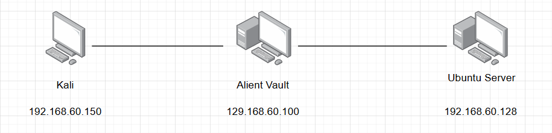

# Triển khai hệ thống giám sát Alient Vault



- cài đặt file iso alient vault trên debian
- Khi màn hình console màu xanh xuất hiện, chọn dòng `3 Jailbreak System` để vào cửa sổ dòng lệnh bash.
- Chạy công cụ quản lý agent:
    
    ```
    bash
    cd/var/ossec/bin/
    ./manage_agents
    ```
    
    
    
- trên máy ubuntu server cài đặt ossec agent
    
    ```bash
    cd /tmp
    wget https://github.com/ossec/ossec-hids/archive/2.8.1.tar.gz -O ossec-2.8.1.tar.gz
    tar -zxvf ossec-2.8.1.tar.gz
    cd ossec-hids-2.8.1
    sudo ./install.sh
    ```
    
- Trả lời các câu hỏi trong quá trình cài đặt:
    - What kind of installation do you want?: Gõ agent
    - Choose where to install: Nhấn Enter (mặc định /var/ossec)
    - What's the IP Address of the OSSEC HIDS server?: Nhập IP AlienVault: 192.168.60.10
    - Các câu hỏi về syscheck, rootcheck, active response: Nhấn Enter chọn y.
- Nhập Key đã lấy từ AlienVault ở Bước 1:
    
    ```bash
    sudo/var/ossec/bin/manage_agents
    ```
    
- Đảm bảo OSSEC theo dõi đúng file log Web và SSH của Ubuntu: Mở file `/var/ossec/etc/ossec.conf`:
    
    ```bash
    sudonano/var/ossec/etc/ossec.conf
    ```
    
- Thêm hoặc kiểm tra xem các thẻ `<localfile>` sau đã có chưa:
    
    ```
    <!-- Log SSH Ubuntu -->
    <localfile>
    <log_format>syslog</log_format>
    <location>/var/log/auth.log</location>
    </localfile>
    
    <!-- Log Web Apache -->
    <localfile>
    <log_format>apache</log_format>
    <location>/var/log/apache2/access.log</location>
    </localfile>
    <localfile>
    <log_format>apache</log_format>
    <location>/var/log/apache2/error.log</location>
    </localfile>
    ```
    
- Khởi động OSSEC Agent:
    
    ```
    bash
    sudo/var/ossec/bin/ossec-controlrestart
    ```
    
- quay lại máy alient vault kiểm tra máy agent đã hoạt động chưa


### 1. **Kịch bản 1: Tấn công dò mật khẩu (Brute-force SSH)**

- tạo danh sách mật khẩu mẫu trên kali
    
    ```bash
    echo -e "123456\npassword\nadmin\n123\nqwerty" > /tmp/pass.txt
    ```
    
- tấn công brute-force bằng hydra
    
    ```bash
    hydra -L /tmp/pass.txt -P /tmp/pass.txt ssh://192.168.60.128 -t 16 -vV
    ```
    
    
    
    
    
- xem rule của alert đó
    
    
