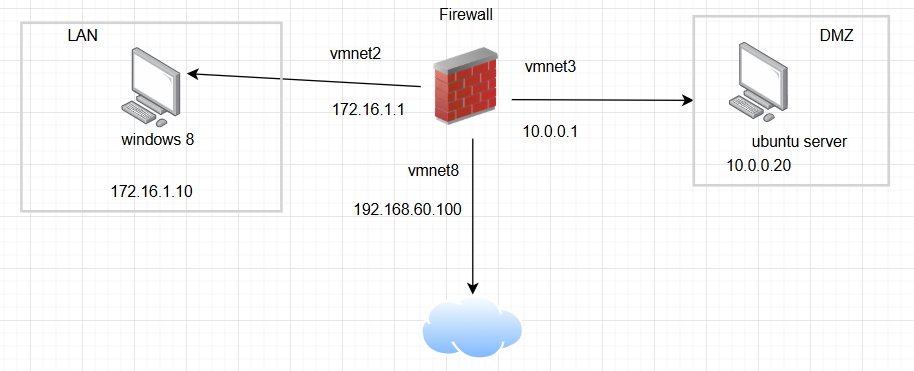

# Thiết lập và cấu hình Firewall Iptable



### 1. Kịch bản 1. Cho phép máy tính trong Lan ping ra ngoài mạng Internet

#### 1.1 Bước 1: Kiểm tra ping

- tại máy trạm ubuntu client thực hiện ping đến máy bên ngoài mạng
- kết quả, không ping được bên ngoài mạng

#### 1.2 Thiết lập Rule trên iptable để cho phép máy ping ra ngoài mạng

- kiểm tra các interface trên máy firewall


- ens33 ra internet, ens37 kết nối đến LAN, ens38 kết nối đến DMZ
    
    ```bash
    iptables -A FORWARD -i ens37 -o ens33 -s 172.16.1.0/24 -p icmp --icmp-type any -j ACCEPT
    iptables -A FORWARD -i ens33 -o ens37 -d 172.16.1.0/24 -p icmp --icmp-type any -j ACCEPT
    sudo iptables -t nat -A POSTROUTING -o ens33 -s 172.16.1.0/24 -j SNAT --to-source 192.168.60.100 #dành cho ip tĩnh
    #sudo iptables -t nat -A POSTROUTING -o ens33 -s 172.16.1.0/24 -j MASQUERADE #dành cho ip động
    sudo sysctl -w net.ipv4.ip_forward=1 #bật ip forwarder
    ```
    
- cài đặt công cụ lưu trữ vĩnh viễn rule của iptable
    
    ```bash
    sudo apt update && sudo apt install -y iptables-persistent
    ```
    
- chạy lệnh sau để các rule được tự động load khi boot
    
    ```bash
    sudo iptables-save | sudo tee /etc/iptables/rules.v4
    ```
    
- lệnh xem rule
    
    ```bash
    iptables -L #tại table mặc định là filter
    iptables -L -t nat #tại bảng nat
    ```
    

#### 1.3 Kiểm tra kết quả


- máy win 8 đã ping được ra internet

### 2. Kịch bản 2. Cho phép máy tính trong LAN truy vấn DNS ra Internet

- thực hiện truy vấn dns tại win7 chưa có dns


- cấu hình rule để cho phép truy vấn dns tại firewall
    
    ```bash
    iptables -A FORWARD -i ens37 -o ens33 -s 172.16.1.0/24 -p udp --dport 53 -j ACCEPT
    iptables -A FORWARD -i ens33 -o ens37 -d 172.16.1.0/24 -p udp --sport 53 -j ACCEPT
    ```
    
- kiểm tra kết quả


### 3.Kịch bản 3. Cho phép máy tính trong mạng LAN truy cập được các website từ mạng Internet

- máy win 8 không thể truy cập vào internet
- cấu hình thêm port 80 và 443
    
    ```bash
    sudo iptables -A FORWARD -i ens37 -o ens33 -s 172.16.1.0/24 -p tcp -m multiport --dport 80,443 -j ACCEPT
    sudo iptables -A FORWARD -i ens33 -o ens37 -d 172.16.1.0/24 -p tcp -m multiport --sport 80,443 -j ACCEPT
    ```
    
- kiểm win 8 đã vào được internet
    
    
    

### 4. Kịch bản 4. Cho phép cập tới máy chủ web trong phân vùng mạng DMZ

- truy cập web server và dns server từ máy thật vào máy trong dmz không được
- cấu hình trên iptables
    
    ```bash
    iptables -t nat -A PREROUTING -i ens33 -p tcp --dport 80 -j DNAT --to-destination 10.0.0.20:80
    iptables -t nat -A PREROUTING -i ens33 -p udp --dport 53 -j DNAT --to-destination 10.0.0.20:53
    ```
    


đã truy cập được vào web server từ máy host
