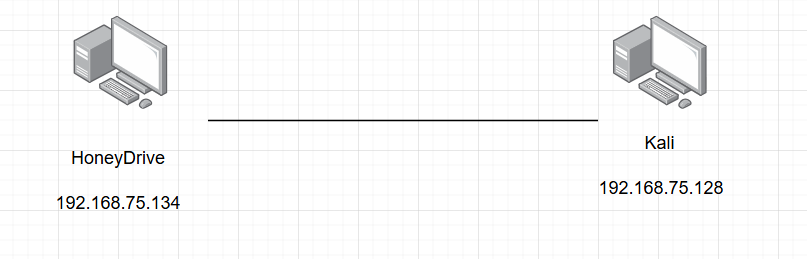

# Triển khai Honeypot sử dụng Honeydrive

- Chạy chương trình Honeypot kippo

- Trên máy thật , truy cập để vào trang quản trị kippo

- dò quét ip và port từ máy kali

- thấy port 22 đang mở

- dùng hydra để brute-force

- vào kippo và phân tích hành vi

