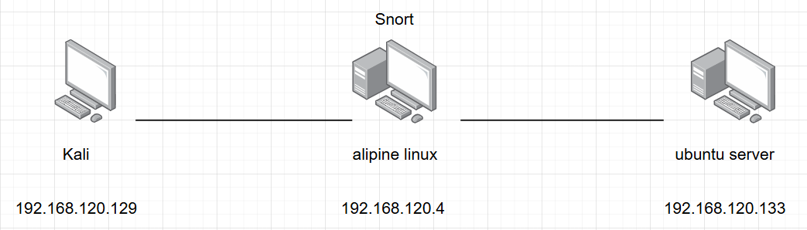

# Triển khai hệ thống IDS Snort



### 1. Set up

- cài đặt snort trên apline linux
    
    ```bash
    # Cập nhật danh sách gói và cài đặt Snort 3 cùng các thư viện phụ thuộc
    apk update
    apk add snort libpcap pcre iproute2
    
    # Tạo thư mục và file local.rules để chứa luật tự viết
    sudo mkdir -p /etc/snort/rules
    sudo touch /etc/snort/rules/local.rules
    ```
    
- mở file /etc/snort/snort.lua
    
    ```bash
    #khai báo biến mạng
    HOME_NET = '192.168.120.0/24'
    EXTERNAL_NET = 'any'
    
    #khai báo module IPS (Intrusion Prevention System)
    ips = 
    {
        include = '/etc/snort/rules/local.rules', #chỉ định path chứa rule
        mode = 'tap', #chỉ lắng nghe mà ko phản hồi
    }
    
    #khai báo định dạng xuất alert
    alert_fast = 
    {
        file = true,          #ghi lại alert tra file
        packet = false,       #chỉ ghi lại những thứ quan trọng mà ko ghi toàn bộ packet
        limit = 0,            #ko giới hạn ghi lại alert
    }
    ```
    

### 2. Kịch bản 1.  Phát hiện tấn công dò quét

- sửa file /etc/snort/rules/local.rules
    
    ```bash
    alert icmp $EXTERNAL_NET any -> $HOME_NET any (msg:"[SCAN] Nmap Ping Sweep / ICMP Echo Request"; itype:8; sid:10000001; rev:1;)
    ```
    
    - chỉ bắt các gói `type=8` (Echo Request)
    - `sid:10000001` là mã định danh duy nhất của rule, 1.000.000 là rule có sẵn, trên là rule tự custom.
    - `rev:1` là phiên bản sửa đổi của rule.
- chạy snort để lắng nghe
    
    ```bash
    snort -c /etc/snort/snort.lua -i eth0 -A alert_fast
    ```
    
- thực hiện tấn công từ máy kali
    
    ```bash
    nmap -sP --disable-arp-ping 192.168.120.0/24
    ```
    
    
    
    
    

### 3. Kịch bản 2. Phát hiện tấn công dò quét dịch vụ và cổng

- thêm rule vào /etc/snort/rules/local.rules
    
    ```bash
    alert tcp $EXTERNAL_NET any -> $HOME_NET any (msg:"SYN scan attack"; flags:S; detection_filter:track by_src, count 30, seconds 2; classtype:network-scan; sid:10000002; rev:1;)
    ```
    
    - `flags:S` kiểm tra cờ syn
    - `detection_filter:track by_src, count 30, seconds 2` gom nhóm và theo dõi một ip_src gửi 30 gói trong vòng 2s.
    - `classtype:network-scan` phân loại hành vi là dò quét mạng
    - sid:10000002
- thực hiện quét port từ máy kali bằng syn scan
    
    ```bash
    nmap -sS -O 192.168.120.133
    ```
    
- chạy snort để lắng nghe
    
    ```bash
    snort -c /etc/snort/snort.lua -i eth0 -A alert_fast
    ```
    


