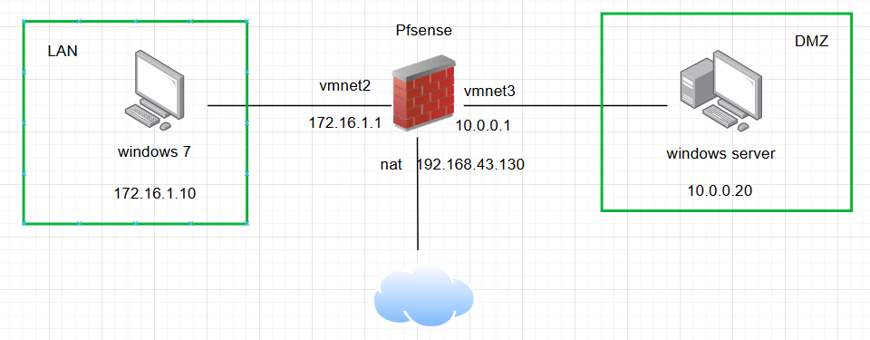

# Triển khai tường lửa Pfsense

- vào giao diện cấu hình của Pfsense để cấu hình, thông tin về cổng mạng
    
    
    

### 1. Kịch bản 0. Xóa các rule mặc định

- truy cập Firewall 🡪 Rules 🡪 LAN

- xóa các rule mặc định, chỉ còn lại rule cho quản trị firewall

### 2. Kịch bản 1. *Cho phép máy trạm trong mạng LAN Ping ra Internet*

- kiểm tra ping trước khi tạo rule

→ không thể ping vì bị firewall chặn

- add thêm rule sau
    
    
    
    
    
- chọn save để lưu
    
    
    
- ping kiểm tra lại, kết quả là đã ping được
    
    
    

### 2. Kịch bản 2. *Cho phép máy tính trong mạng LAN truy vấn DNS ra Internet*

- add rule sau

- kiểm tra

### 3. ***Kịch bản 3:** Cho phép máy tính trong mạng LAN truy cập website qua cổng 80, 443.*

- truy cập website bằng win 7
    
    
    

### 4. ***Kịch bản 4:** Cho phép máy tính ngoài Internet truy cập vào website trên máy chủ DMZ*

- chuyển qua giao diện cấu hình cho WAN, bỏ 2 rule mặc định được tạo sẵn trong mạng wan bằng cách vào setting bỏ 2 tùy chọn sau
    
    
    
- vào phần ADD để tạo rule
    
    
    
    
    
    
    
- Để người dùng ngoài có thể truy cập được cần thực hiện NAT từ ngoài vào trong máy web server. Vào Firewall → NAT và tạo rule sau
    
    
    
    
    
- tại máy vật lý, truy cập vào ip của firewall
    
    
