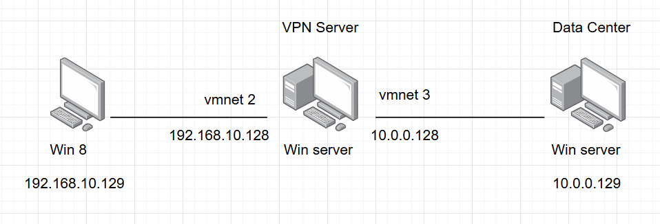

# Cấu hình mạng VPN Client To Site trên nền tảng Windows Server 2012 R2

### 1. Các bước thực hiện

#### 1.1 Thực hiện trên Data Center

- tạo thư mục chia sẻ

#### 1.1 Thực hiện trên VPN server

- cài đặt dịch vụ remote access
    
    Server Manager → Dashboard → (2) Add roles and features
    

- Cấu hình dịch vụ Routing and Remote Access
    - chọn Tools → Routing and Remote Access
    - Chuột phải vào tên máy chủ VPN và chọn Configure and Enable…
        
        
        
        
        
    - Tiếp theo cần phải cấu hình địa chỉ IP sử dụng cho đường hầm. Chuột phải
    vào VPNSERVER chọn Properties → IPv4 → static address pool → Add.
        
        
        
- tạo tài khoản người dùng VPN, tài khoản này được sử dụng để xác thực người dùng truy cập từ xa.
- Từ Server Manager → Tools → Computer Management → Local User and Group → Users. Chuột phải chọn New User.
- Chọn Create để tạo người dùng. Sau khi tài khoản được tạo xong, chuột phải vào tên tài khoản chọn Properties. Trong tab dial-in chọn Allow access.
    
    
    

#### 1.2 Thực hiện trên win 8

- bật cửa sổ quản trị network
- Kích chọn Setup a new connection.
- Cửa sổ tiếp theo chọn Connect to a workplace → Next
- Giao diện tiếp theo chọn Use my Internet Connection
- Giao diện tiếp theo chọn I’ll set up an Internet connection later.
- Giao diện tiếp theo nhập địa chỉ IP bên ngoài của máy chủ VPN (thông thường đây chính là địa chỉ IP Public).

- Nhấn Next để tiếp tục. Giao diện tiếp theo nhập tên tài khoản và mật khẩu đã tạo trên máy chủ
    
    
    
- kiểm tra kết nối tới Data Center
    
    
    
- truy cập vào data center thành công

### 2. Cấu hình VPN với giao thức L2TP kết hợp với IPSec

#### 2.1 Thực hiện trên VPN server

Tại giao diện quản trị VPN Routing and Remote access.
Chuột phải vào tên máy chủ VPN Server → Properties.
Chọn tab Security:

Tích chọn vào ô Allow custom IPsec… Nhập khóa chia sẻ giữa 2 máy là VPN Server và Win7. Khóa này giữ bí mật.
Nhấn Apply → OK. Restart lại dịch vụ VPN.

#### 2.2 Thực hiện trên máy Win 8

