# Lab 3: IPsec

- IPsec có:
    - AH: xác thực và toàn vẹn
        - AH transport: để lộ IP, chỉ thêm AH header
        - AH tunnel: che giấu IP bằng cách thêm IP header mới.
    - ESP: xác thực, toàn vẹn, mã hóa.
        - ESP transport: lộ IP
        - ESP tunnel: che giấu IP bằng cách thêm IP header
    - IKE: giao thức thiết lập kết nối, bắt thay và xác thực mật khẩu, trao đổi khóa
        - b1: (IKE SA) tạo một đường hầm để quản lý, xác thực danh tính, thỏa thuật thuật  toán băm/mã hóa, tạo SPI
        - b2: (child SA): tùy thuộc vào 4 chế độ

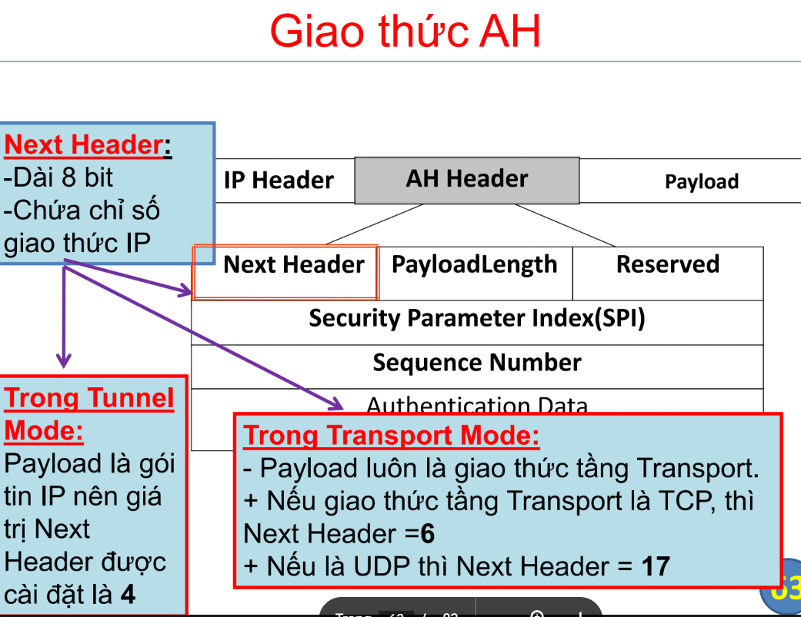

### 1. AH transport

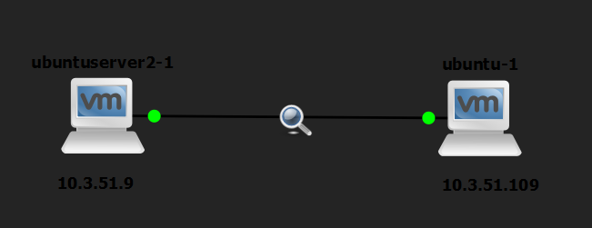

- Cài đặt công cụ strongswan
- tạo PSK cho cả 2 máy
    
    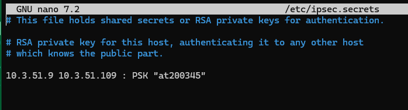
    
    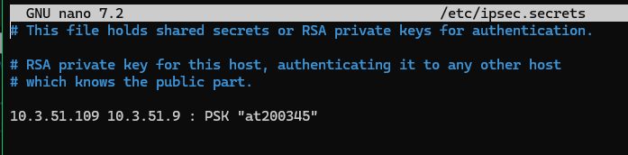
    
- sửa /etc/ipsec.conf máy server (10.3.51.10)
    
    ```jsx
    conn transportAH
    	type=transport
    	left=10.3.51.10
    	right=10.3.51.20
    	authby=secret
    	ah=aes128-sha1
    	auto=start
    ```
    
    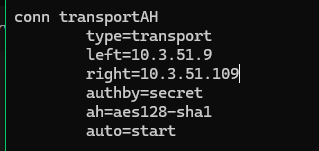
    
    tương tự với máy client
    
    ```jsx
    conn transportAH
    	type=transport
    	left=10.3.51.20
    	right=10.3.51.10
    	authby=secret
    	ah=aes128-sha1
    	auto=start
    ```
    
    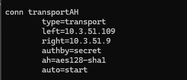
    
- ipsec stop
- ipsec start
- ipsec status
- server tới client
    
    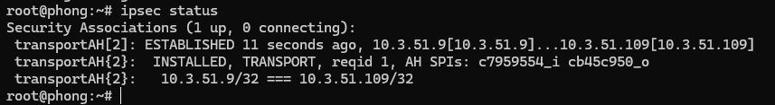
    
    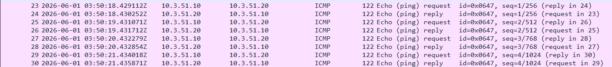
    
- client tới server
    
    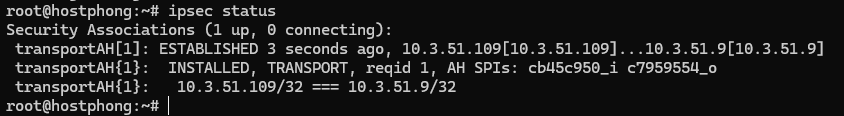
    
    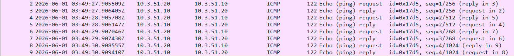
    

### 2. ESP transport

- server

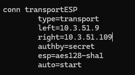

```jsx
conn transportESP
	type=transport
	left=10.3.51.10
	right=10.3.51.20
	authby=secret
	esp=aes128-sha1
	auto=start
```

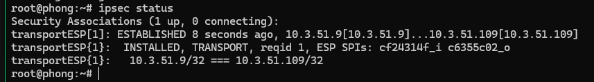

- client

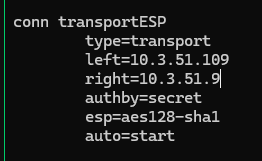

```jsx
conn transportESP
	type=transport
	left=10.3.51.20
	right=10.3.51.10
	authby=secret
	esp=aes128-sha1
	auto=start
```

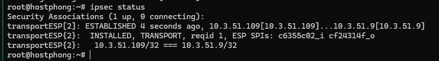

### 3. AH tunnel

- server
    
    ```jsx
    conn tunnelAH
    	type=tunnel
    	left=10.3.51.10
    	right=10.3.51.20
    	authby=secret
    	ah=aes128-sha1
    	auto=start
    ```
    
    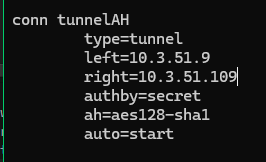
    
    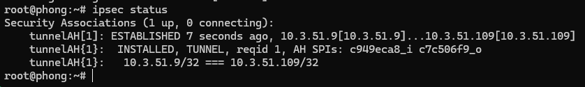
    
- client
    
    ```jsx
    conn tunnelAH
    	type=tunnel
    	left=10.3.51.20
    	right=10.3.51.10
    	authby=secret
    	ah=aes128-sha1
    	auto=start
    ```
    

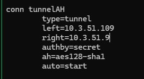

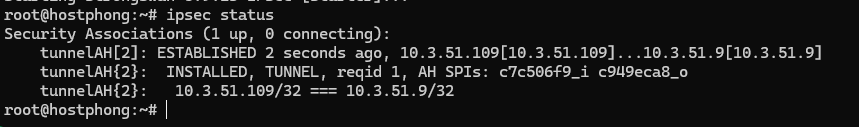

### 4. ESP tunnel

- server
    
    ```jsx
    conn tunnelESP
    	type=tunnel
    	left=10.3.51.10
    	right=10.3.51.20
    	authby=secret
    	esp=aes128-sha1
    	auto=start
    ```
    

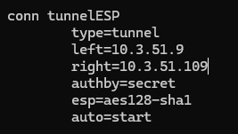

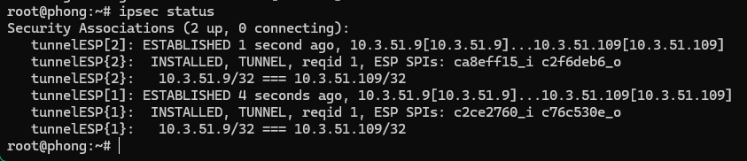

- client
    
    ```jsx
    conn tunnelESP
    	type=tunnel
    	left=10.3.51.20
    	right=10.3.51.10
    	authby=secret
    	esp=aes128-sha1
    	auto=start
    ```
    

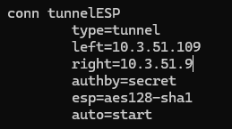

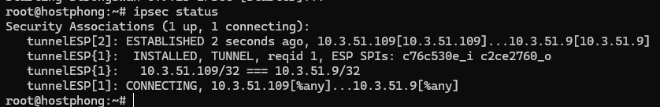