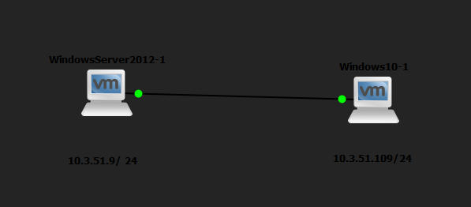
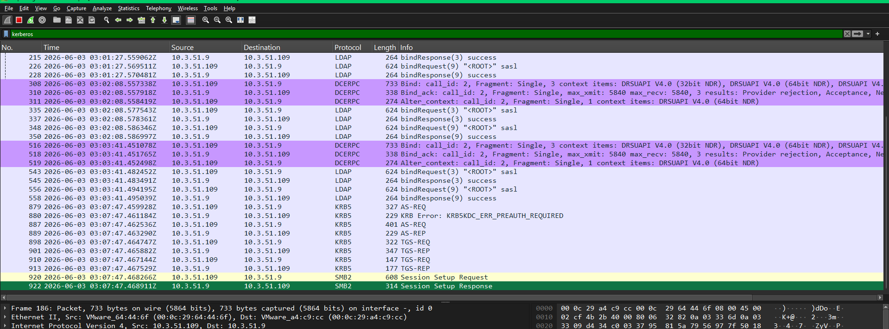
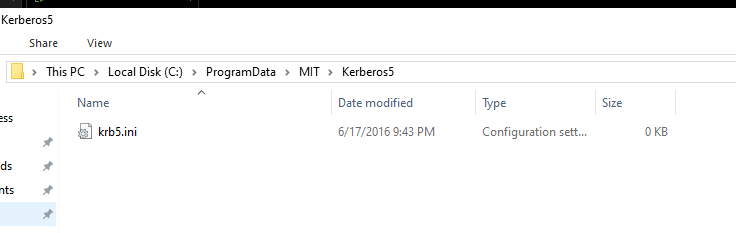
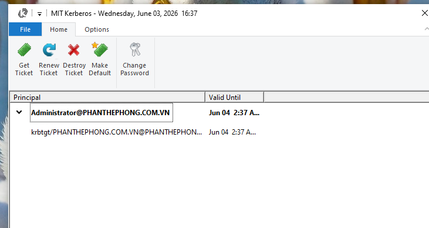
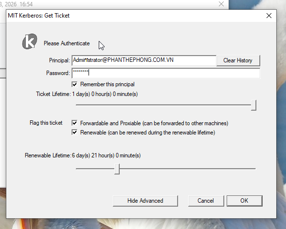
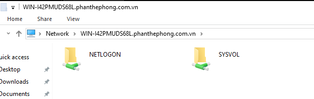

# Lab 2: Kerberos

- KDC (Key Distribution Center), gồm 2 thành phần chính:
    - AS (authentication server): xác thực
    - TGS (ticket grant server)
- 3 bước hoạt động:
    - b1: xác thực với as
        - client nhập username, pass và gửi yêu cầu xác thực đến AS
        - AS kiểm tra thông tin và phản hồi bằng TGT (ticket grant ticket) (mã hóa bằng KBM của TGS)
    - b2: yêu cầu vé từ TGS
        - client sử dụng TGT để yêu cầu vé dịch vụ từ TGS
        - TGS kiểm tra TGT → cung cấp ST (service ticket)
    - b3: truy cập dịch vụ
        - client gửi ST cho server
        - server xác nhận hợp lệ và cho phép sử dụng dịch vụ.

### 1. Thiết lập



- Vào cửa sổ gia nhập dc trên máy win 10 client bằng lệnh
    
    `explorer shell:::{bb06c0e4-d293-4f75-8a90-cb05b6477eee}`
    
- sau khi gia nhập dc thì đã có kerberos mặc định trên os
    
    
    
- Cài kerberos trên win 10
- Vào file config
    
    
    
    ```jsx
    [libdefaults]
    	default_realm = PHANTHEPHONG.COM.VN
    	dns_lookup_kdc = true
    	ticket_lifetime = 24h
    	renew_lifetime = 7d
    	forwardable = true
    	proxiable = true
    	udp_preference_limit = 0
    	default_tkt_enctypes = rc4-hmac
    	default_tgs_enctypes = rc4-hmac
    	default_ccache_name = FILE:C:\krb5\krbcache
    	default_keytab_name = FILE:C:\krb5\krb5.keytab
    	
    [realms]
    	PHANTHEPHONG.COM.VN = {
    		kdc = 10.3.51.9 
    		admin_server = 10.3.51.9
    		default_domain = PHANTHEPHONG.COM.VN 
    	}
    	
    [domain_realm]
    	.PHANTHEPHONG.COM.VN = PHANTHEPHONG.COM.VN
    	PHANTHEPHONG.COM.VN = PHANTHEPHONG.COM.VN
    	
    [logging]
    	default = FILE:C:\krb5\krb5libs.log
    	kdc = FILE:C:\krb5\krb5kdc.log
    	admin_server = FILE:C:\krb5\kadmind.log
    ```
    
- tạo env
    - name: KRB5CCNAME
    - value: FILE:C:\krb5\krbcache
- ấn get ticket
    
    
    



- truy cập smb

