# Lab 1 Pap Chap

### 1. PAP

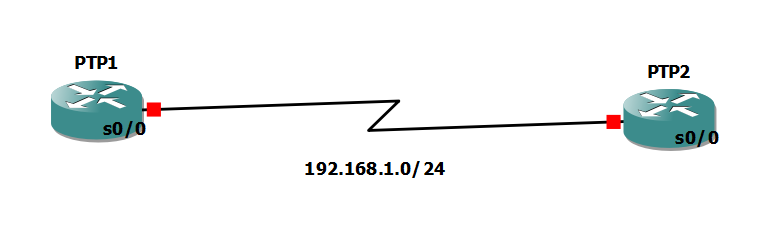

- bật `encapsulation PPP`

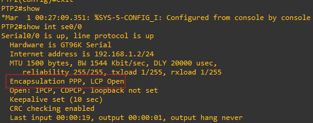

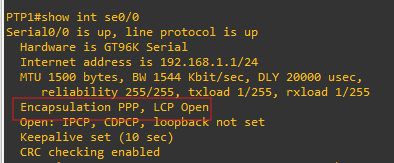

- Tạo tài khoản để xác thực PTP2 và bật PAP trên PTP1
    
    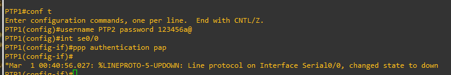
    
- cấu hình gửi username và pass từ PTP2 cho PTP1 với tài khoản đã tạo ở trên để PPT1 tự động xác thực PTP2
    
    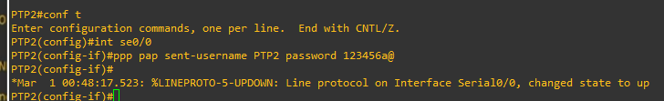
    
- shutdown interface và kiểm tra xem đã bật authentication chưa
    
    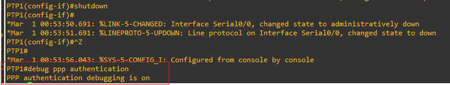
    
    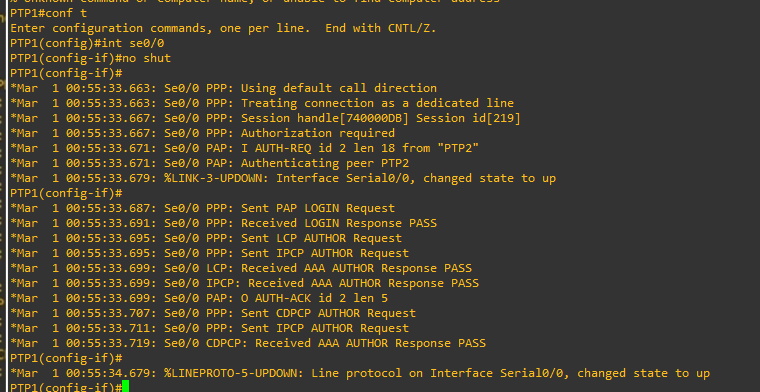
    
- Tương tự
    
    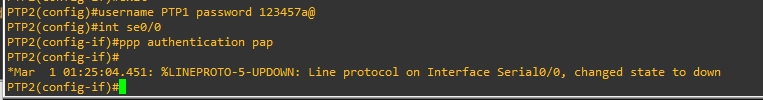
    
    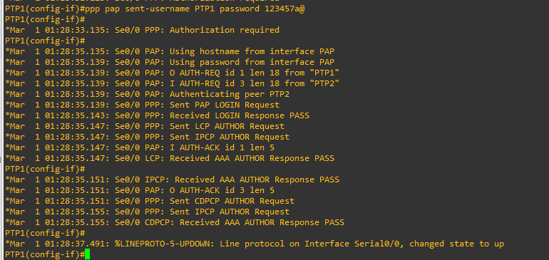
    
    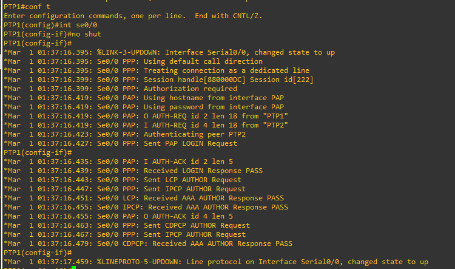
    
- Xác thực 2 chiều thành công trên wireshark
    
    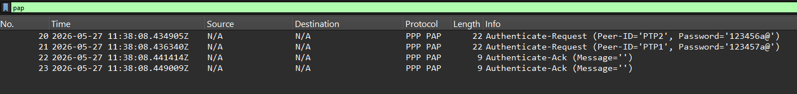
    
    - gói tin 20 gửi thông tin danh tính từ PTP2 tới PTP1 với username và password
    - gói số 21 gửi ngược lại từ PTP1 tới PTP2
    - gói 22 và là lời chấp thuận từ 2 phía (ack)

### 2. CHAP

- Cấu hình PTP1

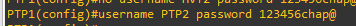

- Cấu hình PTP2

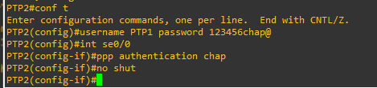

