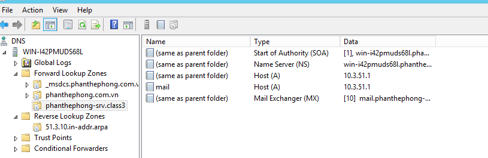

# Lab 6: SMTP, POP3

POP3 (post office protocol v3): để lấy thư từ server về máy, sau khi lấy thì mail trên server sẽ bị xóa

IMAP (internet message access protocol) : giúp lấy thư về không bị xóa trên server

SMTP : gửi thư từ client lên server 

- mdaemon: smtp gửi thư lên server qua port 25, pop3 nhận thư về qua port 110

- trên win 10 download thnderbird
- trên win server download thunderbird và download mdaemon [https://drive.google.com/drive/folders/1lE7LBZaw1_0NMSgO5p-Dxn9Ik4mUcwl5?hl=vi](https://drive.google.com/drive/folders/1lE7LBZaw1_0NMSgO5p-Dxn9Ik4mUcwl5?hl=vi)
- tạo dns
    
    
    
- tạo bản ghi MX
    
    
    
- tạo domain name
    
    
    
- cài đặt mdaemon
- triển khai 2 user
    
    user1@phanthephong-srv.class3
    
    user2@phanthephong-srv.class3 
    
    
    
- tạo tài khoản trên thunderbird
    
    
    
    
    
- đăng nhập user2 trên win 10
    
    
    
- gửi thư từ user2 sang user1
    
    
    
- đã nhận được thư
    
    
    
- trả lời lại
    
    
    
- đã nhận đc thư trả lời
    
    