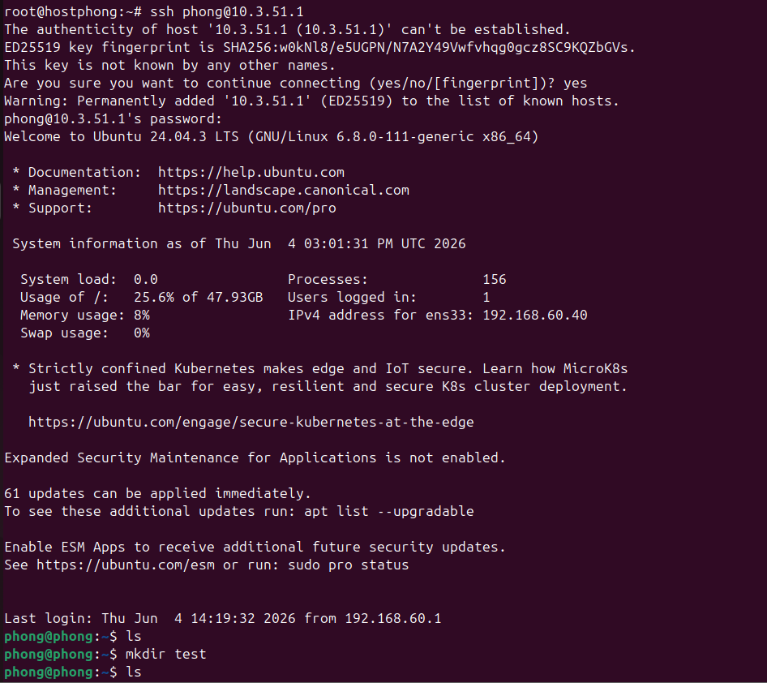
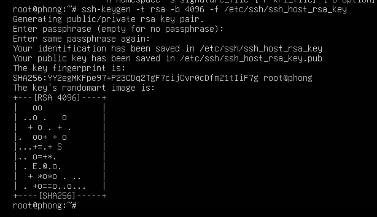
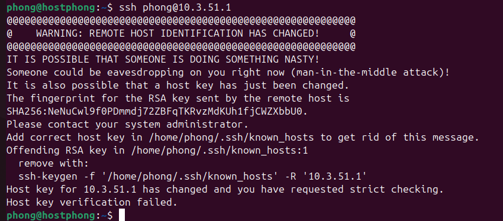
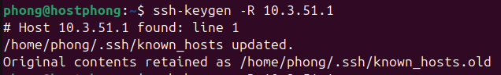
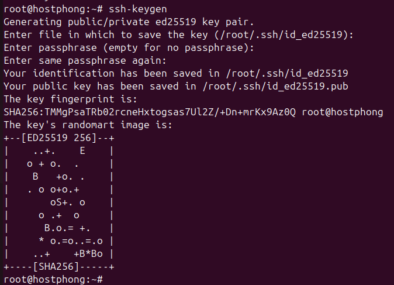
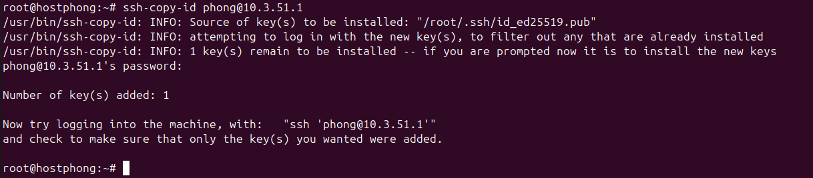
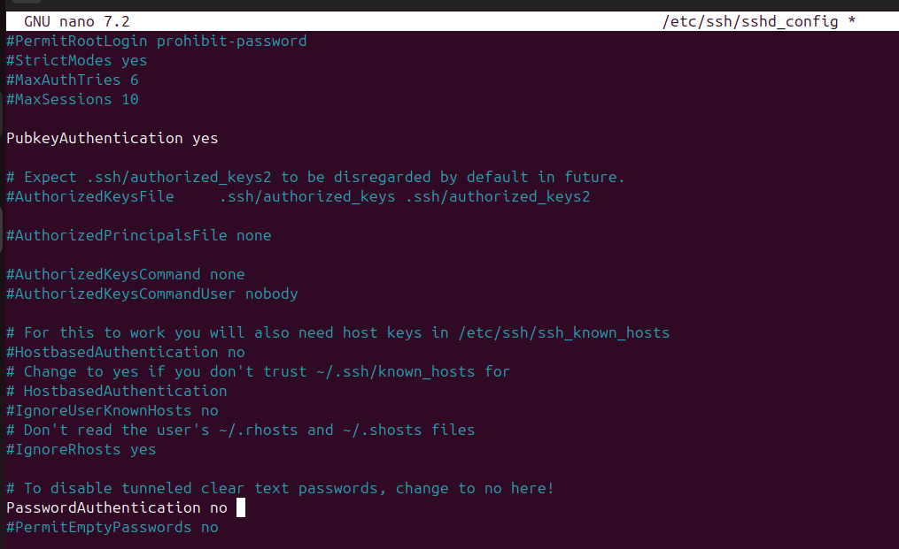
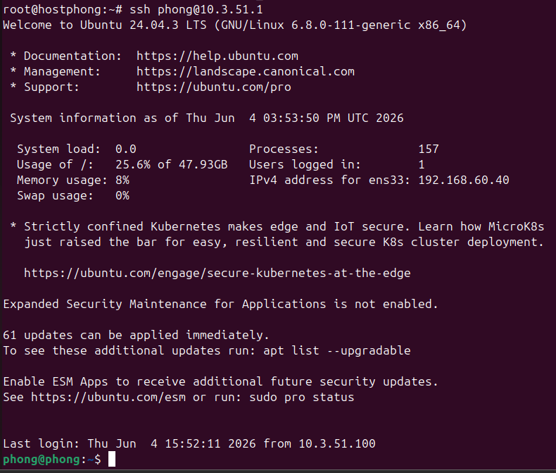

# Lab 5: SSH

ssh có 2 loại cặp khóa là: 

- cặp khóa của user (user key) dùng để xác thực đăng nhập
- cặp khóa của server ssh (server key) dùng để định danh máy chủ, public key là gói tin KEX host key

xác thực server lần đầu: nếu chọn yes thì client sẽ lưu pulic key vào máy, sau đó server gửi lại chữ ký số để client xác thực

Cơ chế xác thực client bằng cặp khóa công khai, server gửi challange, client dùng private key mã hóa rồi gửi cho server, server dùng public key để giải. 

- tải ssh
    
    ```jsx
    apt install openssh-server 
    ```
    
    
    

### 1. Sinh cặp khóa cho máy chủ ssh từ bên ngoài

- xóa hoặc sao lưu các khóa cũ của hệ thống
    
    ```jsx
    rm /etc/ssh/ssh_host_*_key*
    ```
    
- sinh khóa rsa
    
    ```jsx
    ssh-keygen -t rsa -b 4096 -f /etc/ssh/ssh_host_rsa_key
    ```
    
    
    
- khởi động lại ssh
    
    
    
    - khóa đã bị đổi, muốn ssh thì phải xóa publickey của server mà client đã lưu trên máy đi
        
        ```jsx
        ssh-keygen -R 10.3.51.1
        ```
        
        
        

### 2. Triển khai xác thực bằng mã khóa công khai

- tạo cặp khóa trên client
    
    ```jsx
    ssh-keygen
    ```
    
    
    
- đẩy public key sang server
    
    ```jsx
    ssh-copy-id phong@10.3.51.1
    ```
    
    
    
- mở file /etc/ssh/sshd_config để tắt đăng nhập bằng password đi để thử đăng nhập bằng cặp khóa đã tạo
    
    ```jsx
    PubkeyAuthentication yes
    PasswordAuthentication no
    ```
    
    
    
- đăng nhập luôn mà không cần pass
    
    