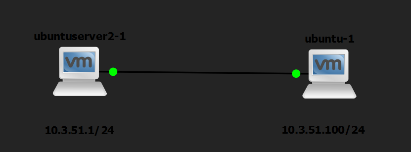

# Lab 4: Telnet



- tải telnetd
- thêm vào file cấu hình trên server
    
    ```jsx
    echo "telnet stream tcp nowait root /usr/sbin/telnetd telnetd" | sudo tee -a /etc/inetd.conf
    systemctl daemon-reload
    systemctl restart inetutils-inetd
    ```
    
    
    
- tạo domain name cho server


- đăng nhập telnet từ client
    
    ```jsx
    telnet 10.3.51.9 
    ```
    
    