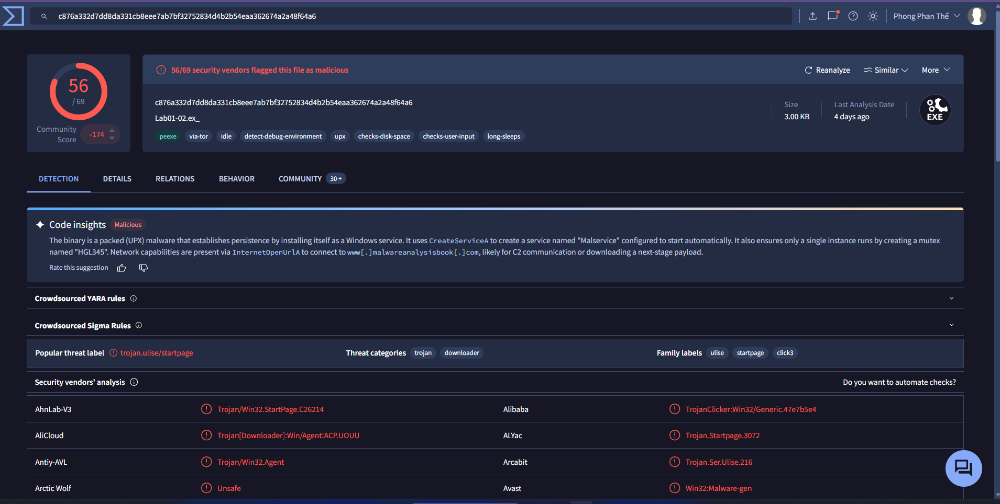

# Lab01-02

> *Q1: Upload the Lab01-02.exe file to [http://www.VirusTotal.com/](http://www.virustotal.com/). Does it match any existing antivirus definitions?*
> 

[https://www.virustotal.com/gui/file/c876a332d7dd8da331cb8eee7ab7bf32752834d4b2b54eaa362674a2a48f64a6](https://www.virustotal.com/gui/file/c876a332d7dd8da331cb8eee7ab7bf32752834d4b2b54eaa362674a2a48f64a6)

- malware này bị packed bằng UPX, tạo persistence bằng windows service. Nó tạo một service tên Malservice chạy tự động
- malware này tạo một mutex HGL345 để đảm bảo chỉ một instance được chạy.
- sau đó nó tạo thread và hẹn time kích hoạt tấn công dos tới địa chỉ http://www.malwareanalysisbook.com

> *Q2: Are there any indications that this file is packed or obfuscated? If so, what are these indicators? If the file is packed, unpack it if possible.*
> 

- malware này bị packed bằng công cụ UPX nên nó hiện các section là UPX như này thay vì .text .data
- cách 2 là dùng PEid
    
    
    
- cách 3 là xem địa chỉ trên disk và địa chỉ trên ram
    
    
    
- có thể thấy size địa chỉ trên disk gần như bằng 0 vì nó đã bị packed lại, nhưng khi chạy lên ram thì size lớn hơn nhiều.
- dùng UPX để unpacked
    
    
    
    
    
- có thể thấy nó đã được unpacked

> *Q3: Do any imports hint at this program’s functionality? If so, which imports are they and what do they tell you?*
> 

- nhóm hàm tạo service: ADVAPI32.dll
    - OpenSCManagerA: mở trình quản lý service của windows
    - CreateServiceA: tạo service
        - StartServiceCtrlDispatcherA: kết nối process của malware tới trình quản lý service của windows để có thể điều khiển và duy trì service.
- nhóm hàm tạo mutex, tạo thread, hẹn giờ kích hoạt: KERNEL32.dll
    - CreateMutexA và OpenMutexA
    - CreateThread: tạo thread để kết nối ra internet.
    - CreateWaitableTimerA, SetWaitableTimer, và WaitForSinngleObject: hẹn time kích hoạt
- nhóm hàm giao tiếp mang: WININET.dll
    - InternetOpenA: mở phiên làm việc với internet
    - InternetOpenUrlA: kết nối đến url cụ thể
    

> *Q4: What host-or network-based indicators could be used to identify this malware on infected machines?*
> 

