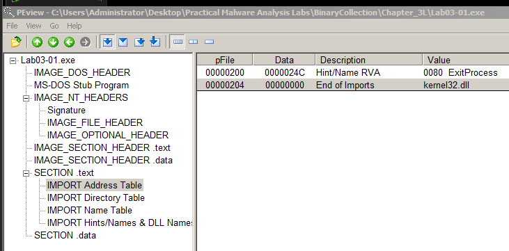

# Lab03-01

> *Q1: What are this malware’s imports and strings?*
> 

- chỉ có thư viện kernel32.dll và hàm ExitProcess điều này làm mình nghĩ file thực thi này có thể đã bị packed.
- nhưng khi xem string từ bintext thì mình thấy vẫn đọc được nhiều hàm import và trong đó có các string quan trọng như domain mà malware này contact ra, các registry

> *Q2: What are the malware’s host-based indicators?*
> 
- khởi chạy process monitor và exclude tất cả các tiến trình hợp pháp đang chạy để dễ dàng quan sát tiến trình malware
- lọc Lower Pane → Handles của file malware

- thấy mutex WinVMX32, cùng với đó là các handles registry liên quan đến kết nối mạng.
- lọc Lower Pane → DLLs của file malware.
    
    
    
- thư viện WSHTCPIP.DLL liên quan đến truyền tải dữ liệu qua mạng
- tiếp theo mình phân tích trong process monitor

- mình tìm được malware này đã tự copy file mã độc của nó và đổi tên thành vmx32to64.exe, sau đó thả file này vào C:\Windows\system32\
- nó tạo ra một registry key là VideoDriver trong key /Run, rồi nó tạo value là vmx32to64.exe. Sau hành động này thì mỗi khi máy được khởi động thì file malware vmx32to64.exe này sẽ tự chạy.

> *Q3: Are there any useful network-based signatures for this malware? If so, what are they?*
> 
- mở file log của inetsim

- mình thấy có truy vấn dns tới www[.]practicalmalwareanalysis[.]com

- trên ws cũng ghi nhận được nhiều request tới domain này.
